# 🛒 E-commerce Sales Analysis — Full Cart Store 2022
An end-to-end **Exploratory Data Analysis (EDA)** of **31,047 item-level sales records** from an Indian fashion e-commerce store, covering the year **2022**. The project follows a complete two-stage workflow. In **Microsoft Excel**, the raw data is checked and cleaned, summarised in **8 pivot tables**, and presented through a **KPI summary and an interactive dashboard**. In **Python / Jupyter**, the same data is validated, cleaned and analysed with `pandas` and `matplotlib`, with charts and checks across **months, product categories, sales channels, states, gender and age groups**. The goal is to understand where **delivered sales** come from and where **cancelled, returned and refunded** records are concentrated, using clear, data-supported findings.


---

## 📑 Table of Contents

1. [Business Problem](#-business-problem)
2. [Project Objectives & Business Questions](#-project-objectives--business-questions)
3. [Dataset Overview](#-dataset-overview)
4. [Tools & Technologies](#-tools--technologies)
5. [Repository Structure](#-repository-structure)
6. [Workflow](#-workflow)
7. [Data Quality & Cleaning](#-data-quality--cleaning)
8. [Part 1 — Excel Analysis](#-part-1--excel-analysis)
9. [Part 2 — Python Analysis](#-part-2--python-analysis)
10. [Key Findings](#-key-findings)
11. [Limitations](#-limitations)
12. [Recommendations & Future Work](#-recommendations--future-work)
13. [How to Run](#-how-to-run)
14. [Author](#-author)

---

## 🎯 Business Problem

The business wants to understand how **recorded delivered sales amounts** vary across **time, product categories, sales channels, and locations**, and where **cancelled, returned, and refunded** records are concentrated.

The data is item-level and some Order IDs appear with more than one status, so the analysis separates **record-level** measures from **order-level** measures wherever it matters.

---

## 🧭 Project Objectives & Business Questions

**Objectives**

- Clean and validate the raw e-commerce sales data.
- Compare recorded delivered amounts across key business dimensions.
- Identify patterns in delivered sales over time.
- Examine where cancelled, returned, and refunded records occur.
- Produce data-supported observations from the available data.

**Business questions**

*Delivered Amount Analysis*
1. Which month has the highest recorded delivered amount?
2. Which state has the highest recorded delivered amount?
3. Which product category and which sales channel have the highest recorded delivered amount?
4. How does the recorded delivered amount differ across gender and age groups?

*Status Analysis (record-level)*
5. How are cancelled, returned, and refunded records distributed across sales channels?
6. What share of all records is Delivered, Returned, Cancelled, and Refunded?

<p align="center">
  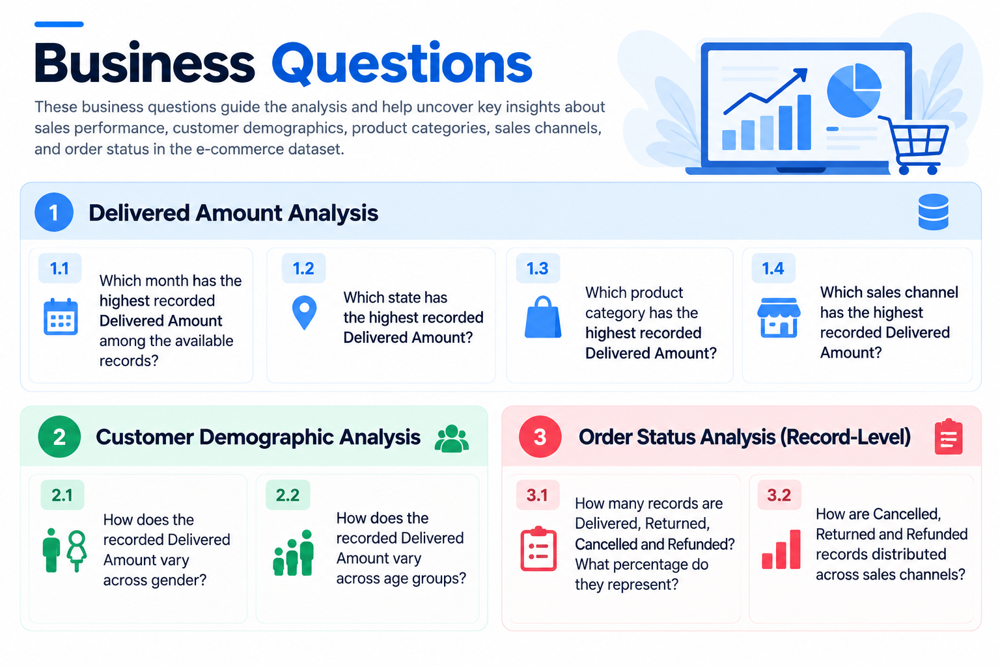
  <br><em>Business Questions</em>
</p>

**Scope notes**

- "Delivered Amount" means the recorded `Amount` on rows with status **Delivered**.
- Cancelled / Returned / Refunded are analysed as **status-based records**.
- The analysis describes patterns; it does **not** establish causes.
- Profit and actual financial loss are **not** measured (no cost or margin fields).

---

## 📦 Dataset Overview

| Item | Detail |
|---|---|
| Source file | `data/full_cart_store_2022.xlsx` (sheet: `Full cart store`) |
| Records | **31,047** item-level rows |
| Unique Order IDs | **28,471** |
| Business columns | 17 (plus an exported `index` column, 18 raw columns) |
| Currency | INR (all records) |
| Date range | 4 Jan 2022 – 6 Dec 2022 |

> ⚠️ **Important date note:** dates fall **only on the 4th, 5th, and 6th of each month** (36 distinct dates). The dataset is a course extract, so every monthly figure covers **at most three days**, not the full month.

**Columns**

| Column | Description |
|---|---|
| `Order ID` | Record-level order identifier (not unique per row) |
| `Cust ID` | Customer identifier |
| `Gender` | Gender label on the item row |
| `Age` | Customer age on the item row |
| `Date` | Date of the record |
| `Status` | Delivered / Returned / Cancelled / Refunded |
| `Channel` | Sales channel (Amazon, Myntra, Flipkart, Ajio, Nalli, Meesho, Others) |
| `SKU` | Product code |
| `Category` | Product category |
| `Size` | Product size |
| `Qty` | Quantity |
| `currency` | Currency of `Amount` (INR) |
| `Amount` | Recorded monetary amount (INR) |
| `ship-city`, `ship-postal-code`, `ship-country` | Shipping location |
| `B2B` | B2B indicator |

---

## 🛠 Tools & Technologies

<p align="center">
  
  
  
  
  
  
  
</p>

| Tool | Used for |
|---|---|
| 📗 **Microsoft Excel** | Data cleaning, helper columns, pivot tables, KPI summary, dashboard |
| 🐍 **Python** (`pandas`, `matplotlib`) | Data cleaning, analysis, charts, validation |
| 📓 **Jupyter Notebook** | Running and documenting the Python analysis |
| 🔧 **Git / GitHub** | Version control and project presentation |

---

## 📁 Repository Structure
```
Ecommerce-Sales-Analysis/
│
├── README.md
│
├── data/
│   ├── full_cart_store_2022.xlsx
│   └── cleaned_ecommerce_sales.csv
│
├── notebooks/
│   └── full_cart_store_analysis.ipynb
│
└── images/
    ├── business_questions.jpeg
    │
    ├── python/
    │   ├── category_analysis.jpeg
    │   ├── channel_analysis.jpeg
    │   ├── data_overview.jpeg
    │   ├── data_quality.jpeg
    │   ├── export_validation.jpeg
    │   ├── gender_age_analysis.jpeg
    │   ├── monthly_analysis.jpeg
    │   ├── state_analysis.jpeg
    │   ├── status_analysis.jpeg
    │   └── status_distribution.jpeg
    │
    └── excel/
        ├── dashboard/
        │   └── ecommerce_dashboard.jpeg
        ├── duplicate_check.jpeg
        ├── kpi_summary.jpeg
        ├── order_id_check.jpeg
        ├── pivot_age_group.jpeg
        ├── pivot_category.jpeg
        ├── pivot_channel.jpeg
        ├── pivot_gender.jpeg
        ├── pivot_monthly_delivered_amount.jpeg
        ├── pivot_order_status_amount.jpeg
        ├── pivot_order_status_distribution.jpeg
        └── pivot_state_analysis.jpeg
```

### 🔗 Quick links to project files and folders

| Item | Location | Description |
|---|---|---|
| 📂 Data folder | [`data/`](data/) | Raw workbook and cleaned dataset |
| 📗 Excel workbook | [`data/full_cart_store_2022.xlsx`](data/full_cart_store_2022.xlsx) | Cleaning, 9 pivot tables, KPI summary, dashboard |
| 📄 Cleaned CSV | [`data/cleaned_ecommerce_sales.csv`](data/cleaned_ecommerce_sales.csv) | Cleaned data exported from Python |
| 📂 Notebooks folder | [`notebooks/`](notebooks/) | Python code |
| 🐍 Python notebook | [`notebooks/full_cart_store_analysis.ipynb`](notebooks/full_cart_store_analysis.ipynb) | Full cleaning, analysis and charts (GitHub renders it in the browser) |
| 📂 Images folder | [`images/`](images/) | All screenshots used in this README |
| 🖼 Python screenshots | [`images/python/`](images/python/) | Code output screenshots |
| 🖼 Excel screenshots | [`images/excel/`](images/excel/) | Pivot table, check and KPI screenshots |
| 📊 Dashboard image | [`images/excel/dashboard/ecommerce_dashboard.jpeg`](images/excel/dashboard/ecommerce_dashboard.jpeg) | Final Excel dashboard |

---

### 🔄 Workflow

```mermaid
flowchart LR
    subgraph EXCEL["📗 Part 1 — Excel"]
        direction LR
        A["📥 Raw Excel Data"] --> B["🧹 Cleaning & Checks"]
        B --> C["📊 Pivot Tables"]
        C --> D["📈 KPI Summary"]
        D --> E["🖥 Dashboard"]
    end

    subgraph PY["🐍 Part 2 — Python"]
        direction LR
        F["📂 Load Data"] --> G["🔍 Quality Checks"]
        G --> H["🧼 Cleaning"]
        H --> I["📉 Analysis & Charts"]
        I --> J["💾 Export Cleaned CSV"]
    end

    EXCEL --> PY

    classDef excel fill:#d4edda,stroke:#217346,color:#000;
    classDef py fill:#dbeafe,stroke:#3776ab,color:#000;
    class A,B,C,D,E excel;
    class F,G,H,I,J py;
````

The Excel workbook contains these sheets:

| Sheet | Purpose |
|---|---|
| `Full cart store` | Raw data |
| `02_cleaned_data` | Cleaned data |
| `Order_ID_Check`, `Duplicate_Check` | Repeated Order ID and duplicate-row checks |
| `03_Data_processing` | Adds Age Group, Month, Month No, State, Unique Order flag |
| `Location`, `PIN_State_Map` | City → state and PIN → state mapping tables |
| `Pivot_*` / `pivot_*` / `Monthly_Sales & Records_03` | Nine pivot tables (see Part 1) |
| `05_KPI_Summary` | KPI table and business highlights |
| `06_Dashboard` | Final dashboard |

---

## 🧹 Data Quality & Cleaning

### Issues found

| Column | Finding | Action |
|---|---|---|
| `Channel` | Trailing whitespace in the column name | Stripped column names |
| `index` | Exported row counter, no business meaning | Dropped |
| `Qty` | `One` / `Two` stored alongside numbers | Converted to numeric (`int64`) |
| `Gender` | `W` / `M` mixed with `Women` / `Men` | Standardised to `Women` / `Men` |
| `Category` | `kurta` has inconsistent capitalisation | Standardised to `Kurta` |
| `Order ID` | Repeated across rows (2,576 repeated values) | Kept; treated as a **non-unique record identifier** |
| `Date` | Only the 4th/5th/6th of each month | Kept as provided; limitation documented |
| `Amount` | No negative or zero values | No change |
| Missing values | None | No change |
| Exact duplicate rows | **0** | Nothing to remove |

### Why repeated Order IDs are not removed

Rows that share an Order ID are **not exact duplicates**, and they often differ in channel, shipping PIN code, age, or gender. 214 Order IDs also carry more than one status. The project therefore reports **"unique Order IDs"** rather than "orders" and reports status shares at the **record level**.

### Validation

The raw DataFrame (`df`, 31,047 × 18) is kept unchanged. The cleaned DataFrame (`df_clean`, 31,047 × 17) has no missing values, an integer `Qty`, only `Women`/`Men` in `Gender`, and consistent category labels. The exported CSV was re-loaded and confirmed to match (same rows and columns).

---

## 📊 Part 1 — Excel Analysis

📗 **Workbook:** [`data/full_cart_store_2022.xlsx`](data/full_cart_store_2022.xlsx) · 🖼 **Screenshots:** [`images/excel/`](images/excel/)

### Data checks

| Order ID check | Duplicate check |
|:---:|:---:|
| 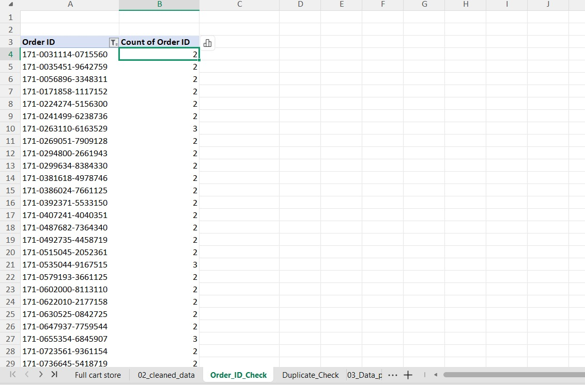 | 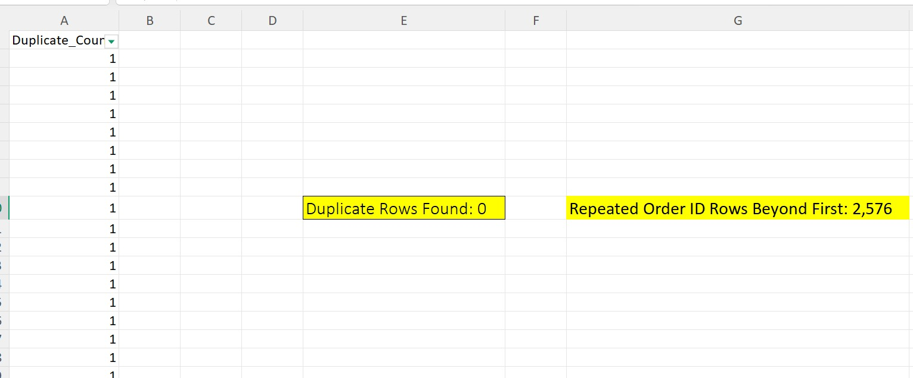 |


### Pivot Table 1 — Monthly Delivered Records & Amount

*(Sheet: `Monthly_Sales & Records_03`; Status filter = Delivered)*

| Month | Delivered Records | Delivered Amount (INR) |
|---|---:|---:|
| January | 2,537 | 1,724,598 |
| February | 2,548 | 1,754,073 |
| March | 2,653 | 1,825,897 |
| April | 2,494 | 1,718,065 |
| May | 2,444 | 1,694,325 |
| June | 2,375 | 1,622,338 |
| July | 2,374 | 1,640,566 |
| August | 2,420 | 1,684,916 |
| September | 2,320 | 1,585,016 |
| October | 2,174 | 1,513,971 |
| November | 2,137 | 1,462,714 |
| December | 2,165 | 1,484,065 |
| **Grand Total** | **28,641** | **19,710,544** |


<p align="center">
  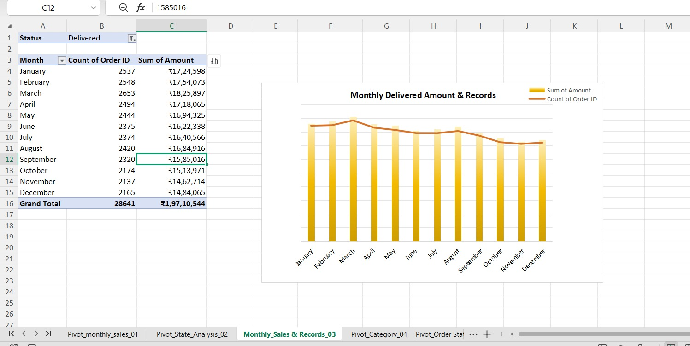
  <br><em>Pivot – Monthly Sales</em>
</p>

**Insight:** March has the highest delivered amount and November the lowest. Delivered amount generally declines from March to November, then rises slightly in December. Each month covers only three sampled days, so this is not a full-month seasonality result.

### Pivot Table 2 — Top 10 States by Delivered Amount

*(Sheet: `Pivot_State_Analysis_02`; Status filter = Delivered)*

| Rank | State | Delivered Amount (INR) |
|---:|---|---:|
| 1 | Maharashtra | 2,780,601 |
| 2 | Karnataka | 2,440,485 |
| 3 | Uttar Pradesh | 1,974,615 |
| 4 | Telangana | 1,578,278 |
| 5 | Tamil Nadu | 1,577,166 |
| 6 | Delhi | 1,206,827 |
| 7 | Kerala | 927,173 |
| 8 | West Bengal | 849,898 |
| 9 | Andhra Pradesh | 849,114 |
| 10 | Haryana | 765,935 |
| | **Top-10 Total** | **14,950,092** |

<p align="center">
  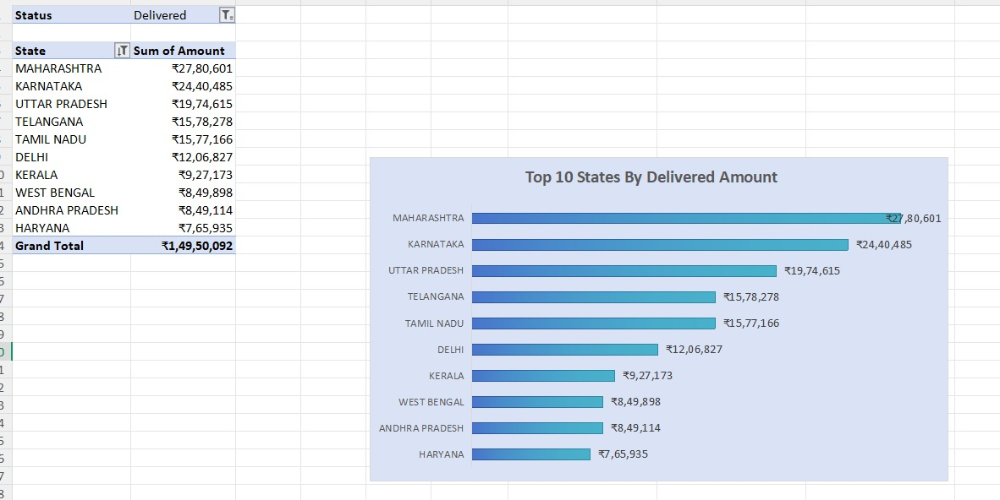
  <br><em>Pivot – State Analysis</em>
</p>

**Insight:** Maharashtra leads, followed by Karnataka and Uttar Pradesh. The total shown is for the **top 10 states only**, not all delivered amount. States come from the shipping city / PIN code mapping (`Location`, `PIN_State_Map`).

### Pivot Table 3 — Delivered Amount by Category

*(Sheet: `Pivot_Category_04`; Status filter = Delivered)*

| Category | Delivered Amount (INR) |
|---|---:|
| Set | 9,991,114 |
| Kurta | 4,547,130 |
| Western Dress | 2,787,574 |
| Top | 1,114,415 |
| Saree | 933,982 |
| Ethnic Dress | 180,643 |
| Blouse | 132,170 |
| Bottom | 23,516 |
| **Grand Total** | **19,710,544** |

<p align="center">
  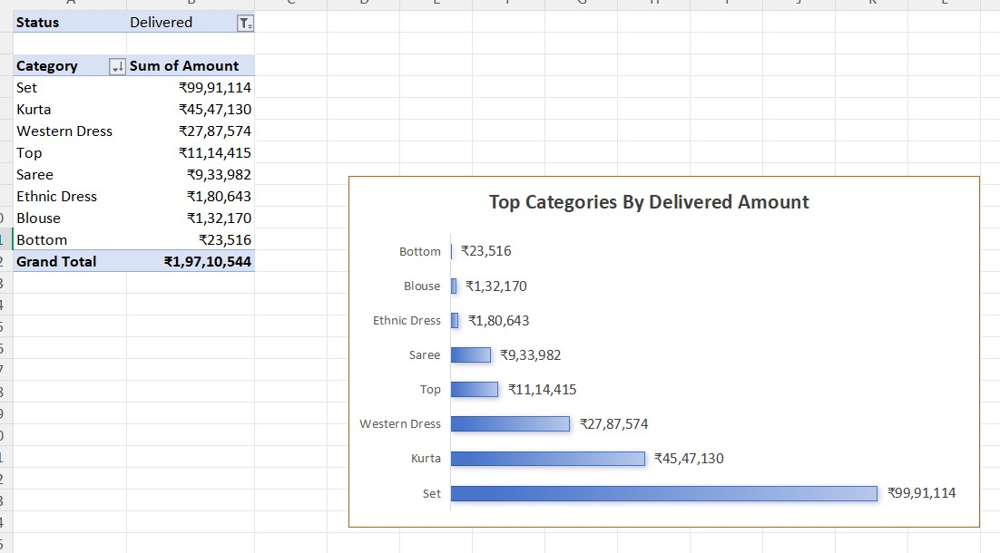
  <br><em>Pivot – Category</em>
</p>

**Insight:** **Set** is the highest-value category with ₹9,991,114, which is **50.7%** of the total delivered amount. **Kurta** (₹4,547,130) and **Western Dress** (₹2,787,574) follow, and these top three categories together make up **87.9%** of delivered sales. **Bottom** is the lowest at ₹23,516 (**0.12%**), so sales are heavily concentrated in a few categories.

### Pivot Table 4 — Recorded Amount by Order Status

*(Sheet: `Pivot_Order Status_05`)*

| Status | Sum of Amount (INR) |
|---|---:|
| Cancelled | 481,844 |
| Delivered | 19,710,544 |
| Refunded | 264,842 |
| Returned | 719,147 |
| **Grand Total** | **21,176,377** |

<p align="center">
  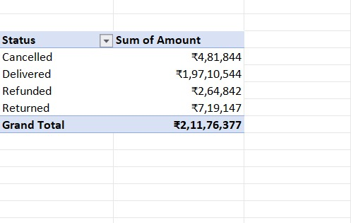
  <br><em>Pivot – Order Status Amount</em>
</p>

> Non-delivered statuses also carry recorded amounts, so the grand total is **not** treated as revenue. Only the Delivered Amount is used as the sales measure.

### Pivot Table 5 — Record Count by Status

*(Sheet: `pivot_Status Count_06`)*

| Status | Records | % of Records |
|---|---:|---:|
| Delivered | 28,641 | 92.25% |
| Returned | 1,045 | 3.37% |
| Cancelled | 844 | 2.72% |
| Refunded | 517 | 1.67% |
| **Grand Total** | **31,047** | |

<p align="center">
  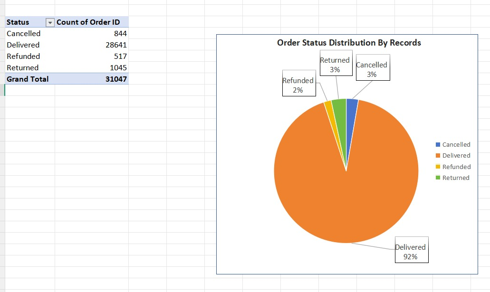
  <br><em>Pivot – Order Status Distribution</em>
</p>

### Pivot Table 6 — Records by Sales Channel

*(Sheet: `Pivot_Channel Analysis_07`; all statuses)*

| Channel | Records |
|---|---:|
| Amazon | 11,016 |
| Myntra | 7,254 |
| Flipkart | 6,703 |
| Ajio | 1,931 |
| Nalli | 1,484 |
| Meesho | 1,398 |
| Others | 1,261 |
| **Grand Total** | **31,047** |

<p align="center">
  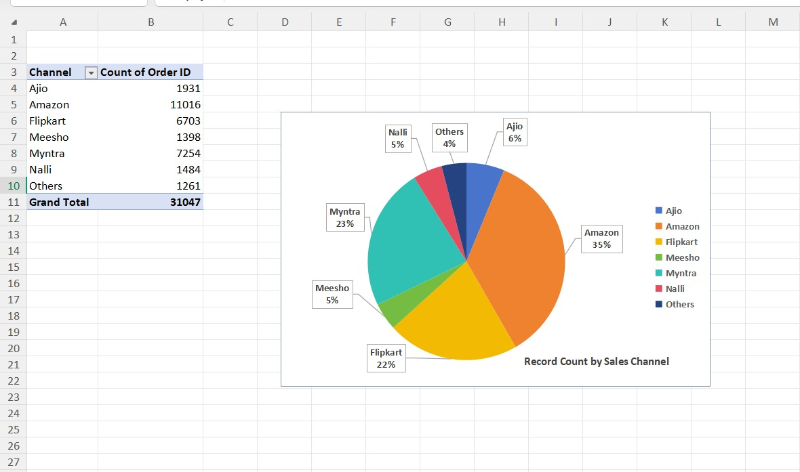
  <br><em>Pivot – Channel</em>
</p>

### Pivot Table 7 — Records by Gender

*(Sheet: `Pivot_Gender_Analysis_08`; all statuses)*

| Gender | Records |
|---|---:|
| Women | 21,553 |
| Men | 9,494 |
| **Grand Total** | **31,047** |

<p align="center">
  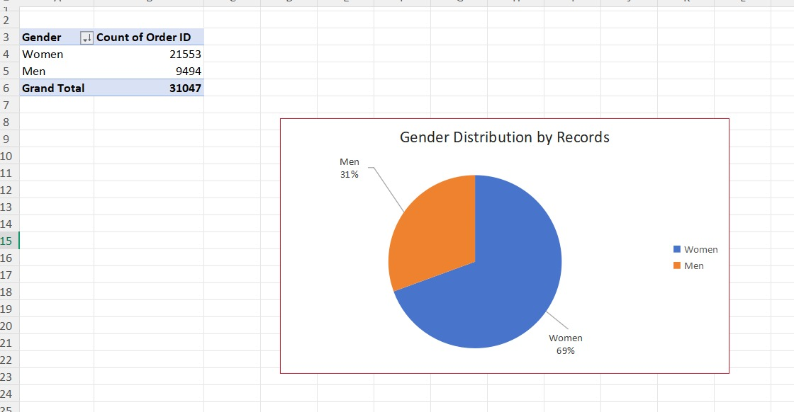
  <br><em>Pivot – Gender</em>
</p>

### Pivot Table 8 — Records by Age Group and Gender

*(Sheet: `Pivot_Age_Group_09`)*

Age groups are defined in `03_Data_processing`: **Young Adult** = under 30, **Adult** = 30–50, **Senior** = over 50.

| Age Group | Men | Women | Grand Total |
|---|---:|---:|---:|
| Young Adult | 2,855 | 6,560 | 9,415 |
| Adult | 4,862 | 10,861 | 15,723 |
| Senior | 1,777 | 4,132 | 5,909 |
| **Grand Total** | **9,494** | **21,553** | **31,047** |

<p align="center">
  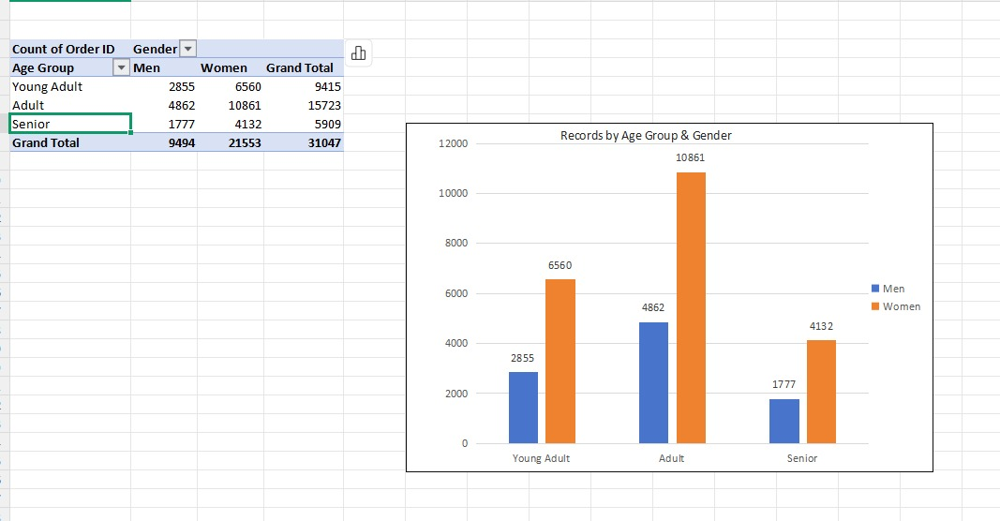
  <br><em>Pivot – Age Group</em>
</p>

### KPI Summary

*(Sheet: `05_KPI_Summary`)*

| KPI | Value |
|---|---:|
| Total Records | 31,047 |
| Unique Order IDs | 28,471 |
| Delivered Records | 28,641 |
| Delivered Amount | ₹19,710,544 |
| Delivery Record Rate | 92.25% |
| Cancelled Records | 844 |
| Returned Records | 1,045 |
| Refunded Records | 517 |
| Non-Delivered Records | 2,406 |
| Non-Delivered Record Rate | 7.75% |

| Business Highlight | Result |
|---|---|
| Top State by Delivered Amount | Maharashtra |
| Top Category by Delivered Amount | Set |
| Top Sales Channel by Records | Amazon |
| Highest Recorded Delivered Amount Month | March |

<p align="center">
  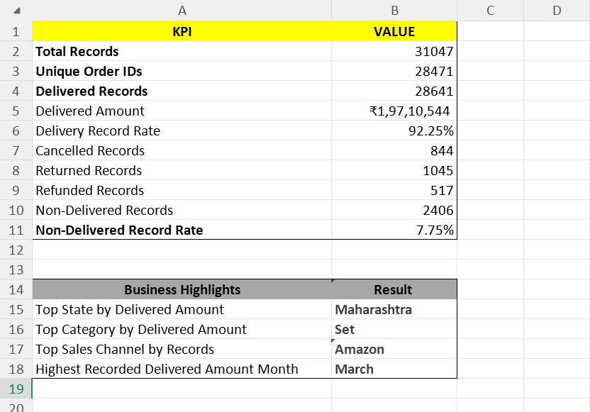
  <br><em>KPI Summary</em>
</p>

### Dashboard

<p align="center">
  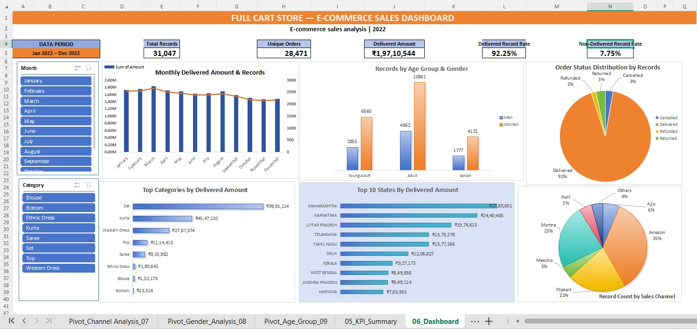
  <br><em>E-commerce Dashboard</em>
</p>

---

## 🐍 Part 2 — Python Analysis

📓 **Code file:** [`notebooks/full_cart_store_analysis.ipynb`](notebooks/full_cart_store_analysis.ipynb) · 📂 **Folder:** [`notebooks/`](notebooks/) · 🖼 **Screenshots:** [`images/python/`](images/python/)

### 2.1 Data overview

Loads the raw sheet with `pandas` and inspects shape (31,047 × 18), column names, data types and the first rows.

<p align="center">
  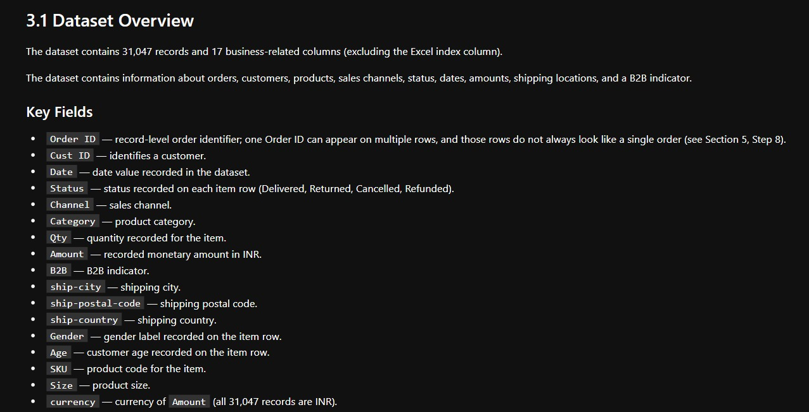
  <br><em>Data Overview</em>
</p>

### 2.2 Data quality checks

Checks missing values, repeated Order IDs, exact duplicates, `Qty` / `Gender` / `Category` / `Status` / `Channel` value counts, the `Age` and `Amount` distributions and the date pattern.

<p align="center">
  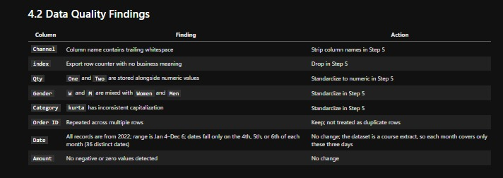
  <br><em>Data Quality</em>
</p>

### 2.3 Status analysis

Compares rows, unique Order IDs, quantity and recorded amount across statuses, and checks the 214 Order IDs that carry more than one status.

| Status | Rows | Unique Order IDs | Quantity | Recorded Amount (INR) |
|---|---:|---:|---:|---:|
| Delivered | 28,641 | 26,356 | 28,822 | 19,710,544 |
| Returned | 1,045 | 1,001 | 1,050 | 719,147 |
| Cancelled | 844 | 831 | 844 | 481,844 |
| Refunded | 517 | 501 | 521 | 264,842 |

> Unique Order ID counts by status overlap (they sum to 28,689 against 28,471 distinct IDs), so they should not be added together.

<p align="center">
  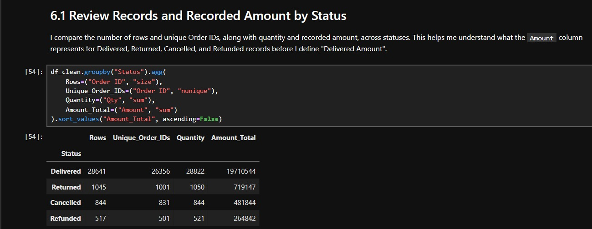
  <br><em>Status Analysis</em>
</p>

### 2.4 Status distribution

<p align="center">
  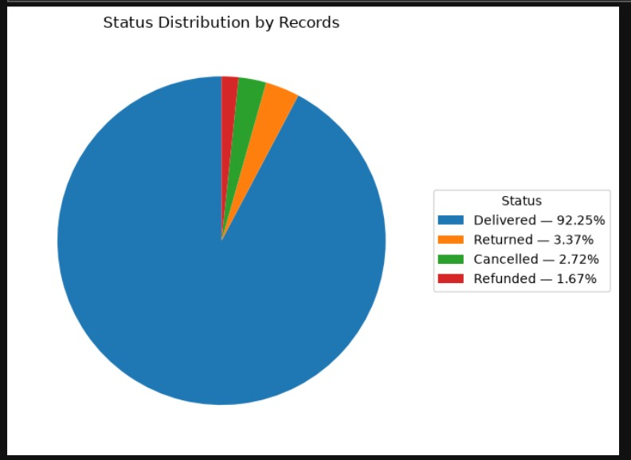
  <br><em>Status Distribution</em>
</p>

Delivered rows are **92.25%** of records; Returned, Cancelled and Refunded together are **7.75%** (2,406 records). These are record-level percentages, not order-level delivery or return rates.

### 2.5 Monthly analysis

| Month | Unique Order IDs | Delivered Amount (INR) | Delivered Quantity |
|---|---:|---:|---:|
| January | 2,314 | 1,724,598 | 2,552 |
| February | 2,323 | 1,754,073 | 2,567 |
| March | 2,455 | 1,825,897 | 2,676 |
| April | 2,310 | 1,718,065 | 2,512 |
| May | 2,252 | 1,694,325 | 2,466 |
| June | 2,185 | 1,622,338 | 2,390 |
| July | 2,161 | 1,640,566 | 2,387 |
| August | 2,231 | 1,684,916 | 2,431 |
| September | 2,129 | 1,585,016 | 2,336 |
| October | 2,012 | 1,513,971 | 2,185 |
| November | 1,991 | 1,462,714 | 2,149 |
| December | 1,993 | 1,484,065 | 2,171 |

<p align="center">
  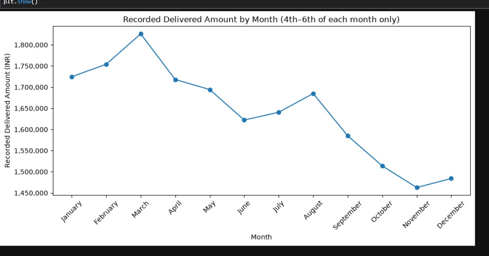
  <br><em>Monthly Analysis</em>
</p>

### 2.6 Category analysis

| Category | Delivered Amount (INR) | Delivered Quantity |
|---|---:|---:|
| Set | 9,991,114 | 11,820 |
| Kurta | 4,547,130 | 9,541 |
| Western Dress | 2,787,574 | 3,607 |
| Top | 1,114,415 | 2,048 |
| Saree | 933,982 | 1,275 |
| Ethnic Dress | 180,643 | 245 |
| Blouse | 132,170 | 221 |
| Bottom | 23,516 | 65 |

<p align="center">
  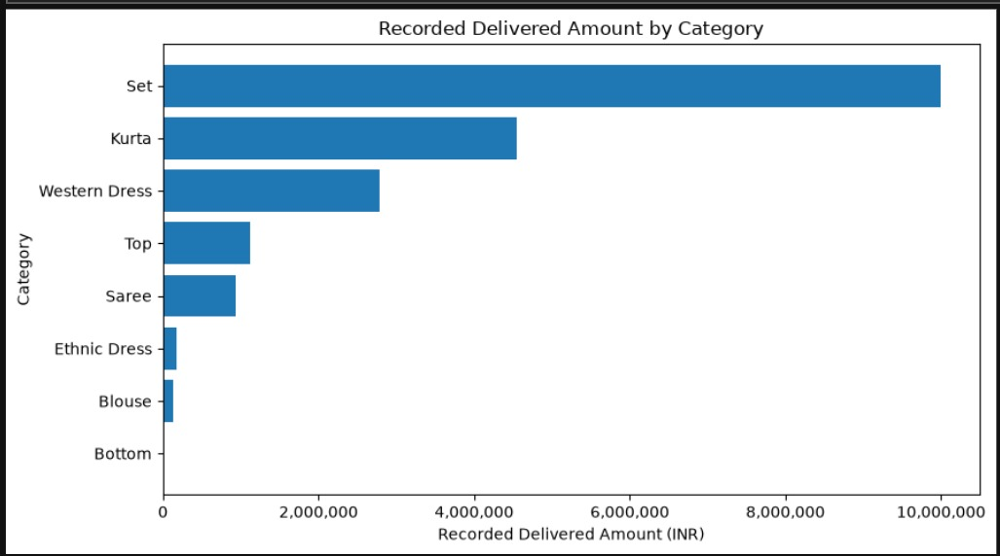
  <br><em>Category Analysis</em>
</p>

### 2.7 Sales channel analysis

**Delivered amount by channel**

| Channel | Delivered Amount (INR) |
|---|---:|
| Amazon | 6,972,495 |
| Myntra | 4,617,456 |
| Flipkart | 4,252,270 |
| Ajio | 1,244,810 |
| Nalli | 945,211 |
| Meesho | 866,133 |
| Others | 812,169 |

**Cancelled, Returned and Refunded records by channel**

| Channel | Cancelled | Refunded | Returned | Non-Delivered Rate |
|---|---:|---:|---:|---:|
| Amazon | 308 | 201 | 383 | 8.10% |
| Flipkart | 188 | 113 | 229 | 7.91% |
| Meesho | 38 | 25 | 47 | 7.87% |
| Myntra | 188 | 116 | 237 | 7.46% |
| Nalli | 34 | 22 | 53 | 7.35% |
| Ajio | 54 | 24 | 60 | 7.15% |
| Others | 34 | 16 | 36 | 6.82% |

<p align="center">
  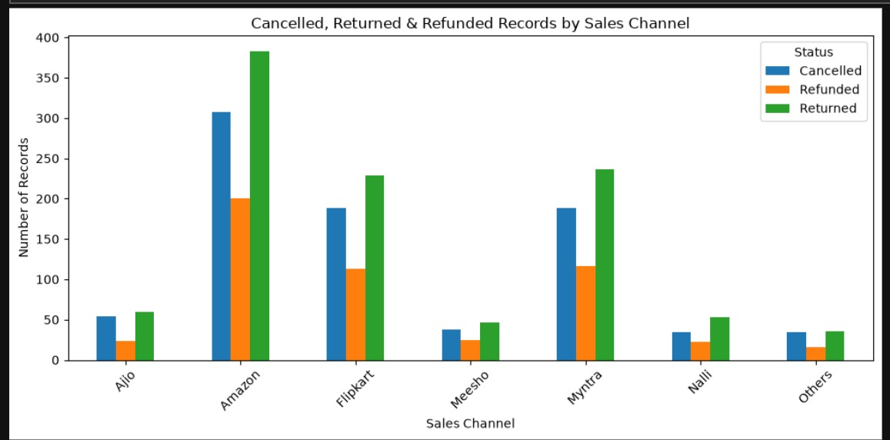
  <br><em>Channel Analysis</em>
</p>

### 2.8 State analysis

State is taken from the `State` column of the `03_Data_processing` sheet (based on shipping city and PIN code). The state totals reconcile to the total delivered amount (₹19,710,544).

<p align="center">
  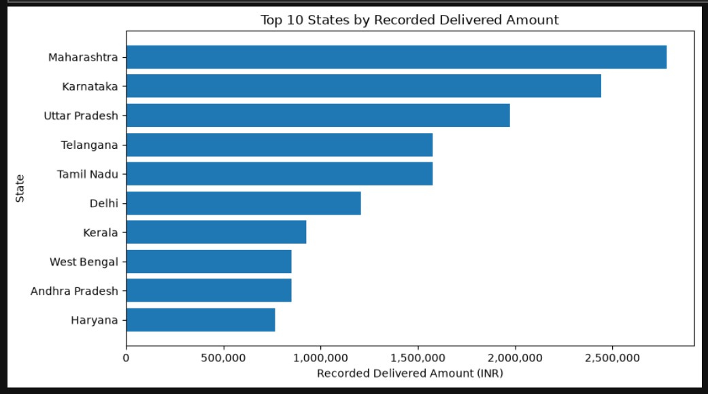
  <br><em>State Analysis</em>
</p>

### 2.9 Gender and age analysis

**By gender (Delivered)**

| Gender | Delivered Amount (INR) | Delivered Quantity |
|---|---:|---:|
| Women | 12,666,129 | 20,026 |
| Men | 7,044,415 | 8,796 |

**By age band (Delivered)**

| Age Group | Delivered Amount (INR) | Delivered Quantity | Unique Customers |
|---|---:|---:|---:|
| 18-25 | 3,940,893 | 5,781 | 5,631 |
| 26-35 | 4,987,568 | 7,291 | 7,063 |
| 36-45 | 4,925,200 | 7,195 | 6,998 |
| 46-55 | 2,780,074 | 4,047 | 3,962 |
| 56-65 | 1,322,951 | 1,962 | 1,932 |
| 66+ | 1,753,858 | 2,546 | 2,509 |

> The Python analysis uses six age bands, while the Excel pivot uses three groups (Young Adult / Adult / Senior). Both are valid summaries of the same `Age` column.

<p align="center">
  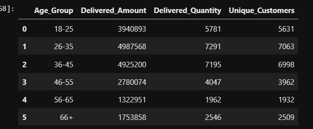
  <br><em>Gender & Age Analysis</em>
</p>

**Data-quality caveat:** among 26,327 customers with Delivered records, 1,830 show more than one age and 622 show more than one gender label. Age and gender figures reflect the labels on item rows and may count one customer in several groups, so **no customer-level age/gender conclusions are drawn**.

### 2.10 Export validation

The cleaned data is saved to `data/cleaned_ecommerce_sales.csv` and re-loaded to verify it: 31,047 rows, 17 columns, no index column, no missing values, `Qty` is integer, `Gender` is `Men`/`Women`, and category labels are consistent.

> The exported CSV does **not** include `State`, which comes from the Excel `03_Data_processing` sheet.

<p align="center">
  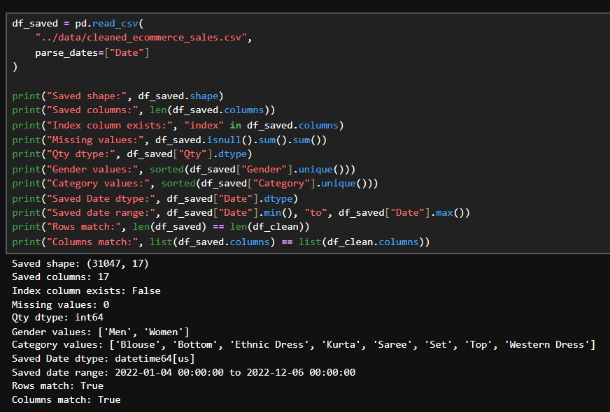
  <br><em>Export Validation</em>
</p>

---

## 🔑 Key Findings

1. **Delivery status:** 28,641 of 31,047 records (**92.25%**) are Delivered, with a Delivered Amount of **₹19,710,544**. This is a record-level share, not an order-level delivery rate.
2. **Non-delivered records:** 2,406 records (**7.75%**) are Returned (1,045; 3.37%), Cancelled (844; 2.72%) or Refunded (517; 1.67%). Financial loss cannot be calculated because cost and refund-amount fields are not available.
3. **Category:** **Set** has the highest Delivered Amount (₹9,991,114; 50.7%). Set, Kurta and Western Dress together account for 87.9%. Bottom is the lowest (₹23,516; 0.12%).
4. **Sales channel:** **Amazon** has the most records (11,016; 35.5%) and the highest Delivered Amount (₹6,972,495; 35.4%). Amazon, Myntra and Flipkart together account for 80.4% of the Delivered Amount.
5. **Non-delivered by channel:** Amazon has the most Cancelled, Returned and Refunded records (892 of 2,406), in line with its volume. Measured against each channel's own records, rates are similar: from 6.82% (Others) to 8.10% (Amazon).
6. **State:** **Maharashtra** leads (₹2,780,601; 14.1%), followed by Karnataka (₹2,440,485) and Uttar Pradesh (₹1,974,615), together 36.5%.
7. **Monthly pattern:** **March** is highest (₹1,825,897) and **November** lowest (₹1,462,714), with a small rise in December (₹1,484,065). Each month covers only three sampled days.
8. **Data quality:** Order ID is not a reliable unique order identifier, and customer age/gender values are inconsistent for some customers.

---

## ⚠️ Limitations

- Dates cover only the 4th–6th of each month, so monthly results are **not** full-month performance.
- No cost, margin, fee or refund-amount data, so **profit and financial loss are not measured**.
- Order ID repeats across rows that often differ in channel, PIN code, age or gender; statuses are reported at record level.
- A few city/PIN-to-state mappings could not be fully verified (about ₹4,419, roughly 0.02% of the Delivered Amount, which is too small to change the top states).
- Findings describe patterns in this dataset; they do not explain **why** they occur.

---

## 💡 Recommendations & Future Work

**Supported by the current findings**

1. Confirm with the data owner what `Order ID` represents, and verify the few city/PIN-to-state mappings, before reporting order-level or state-level KPIs.
2. Compare channels using rates rather than raw counts; add fees, advertising costs and margins before any channel-investment decision.
3. Review the concentration in the **Set** category (50.7%) alongside stock, cost and return information before making inventory decisions.

**Future analysis**

4. Compare Returned / Cancelled / Refunded rates by category, size, SKU and state (add reason codes if available).
5. Rebuild the time series with **every day of each month** before drawing conclusions about seasonality.
6. Add cost, margin, fee and refund-amount data to measure profitability.
7. Revisit gender, age and repeat-purchase analysis once customer identifiers and demographics are consistent.

---

## ▶️ How to Run

### Requirements

| Requirement | Details |
|---|---|
| 🐍 Python | 3.8 or higher |
| 📚 Libraries | `pandas`, `matplotlib`, `openpyxl`, `jupyter` |
| 📗 Microsoft Excel | To open the workbook, pivot tables and dashboard |

### Steps

**1. Clone the repository**

```bash
git clone https://github.com/papia0403/Ecommerce-Sales-Analysis.git
cd Ecommerce-Sales-Analysis
```

**2. Install the required libraries**

```bash
pip install pandas matplotlib openpyxl jupyter
```

**3. Open the Python notebook**

```bash
cd notebooks
jupyter notebook full_cart_store_analysis.ipynb
```

**4. Explore the Excel workbook**

Open [`data/full_cart_store_2022.xlsx`](data/full_cart_store_2022.xlsx) and review the pivot sheets, `05_KPI_Summary` and `06_Dashboard`.

> 💡 The notebook reads the workbook from `../data/full_cart_store_2022.xlsx`, so keep the folder structure unchanged and run the notebook from inside the `notebooks/` folder.

---

## 👤 Author

<p align="center">
  <b>Papia Khatun</b><br>
  <i>Data Analytics Enthusiast</i>
</p>

<p align="center">
  <a href="https://www.linkedin.com/in/papia-khatun-635761310/"></a>
  <a href="https://github.com/papia0403"></a>
  <a href="mailto:khatupapia032@gmail.com"></a>
</p>

<p align="center">
  <i>This project was completed as part of a data analytics course.</i><br>
  ⭐ If you found this project useful, feel free to star the repository.
</p>
